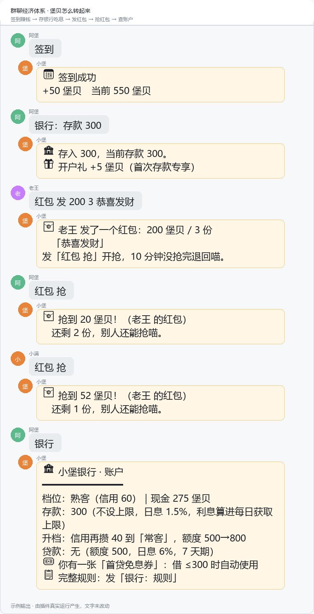
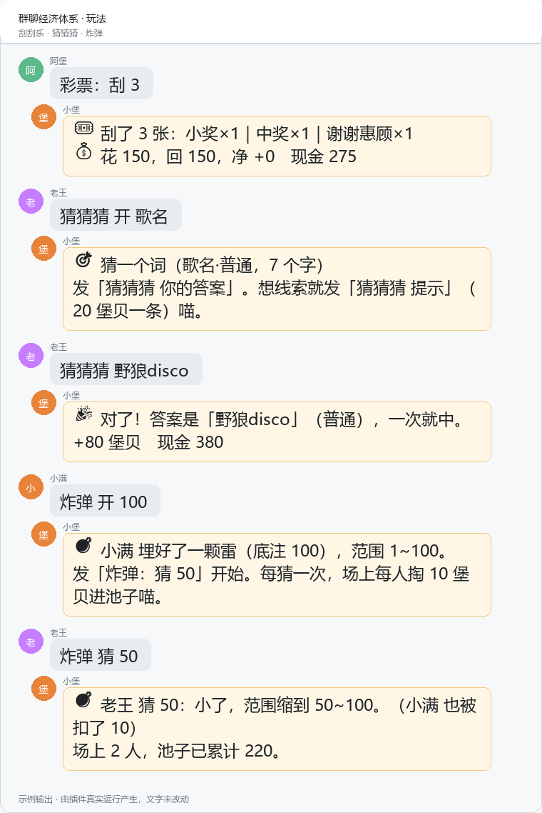

# 群聊经济体系 · AstrBot 插件

> 一个能自洽运转的群聊经济体：赚钱、存钱、借钱、赌钱、还不上的钱被收走。

[](https://github.com/Percent-51/astrbot_plugin_group_economy/actions/workflows/smoke.yml)


**堡贝**（bǎo bèi）是本插件里唯一流通的货币。它没有任何现实价值，但只要群里有第二个人在乎它，这套体系就能把一群潜水的人拽出来说话。

---

## 为什么不是一个「小游戏合集」

大多数群聊游戏插件是这样一批东西：签到加金币、抽卡扣金币、红包发金币。金币只是个计分板，因为它**只能进、不能出**，攒到几万之后谁都懒得再玩。

这个插件把「出口」做出来了：

```
         ┌─────────────── 赚 ───────────────┐
         │  签到 · 猜猜猜 · 接龙 · BOSS 式分红  │
         └────────────────┬─────────────────┘
                          ↓
                  ┌──── 堡贝 ────┐
                  ↓              ↓
          ┌── 存 ──┐        ┌── 花 ──┐
          │ 银行吃息 │        │ 彩票/炸弹 │
          │ 信用贷周转│        │  抽成销毁 │
          └────┬───┘        └────┬────┘
               ↓                 ↓
        还不上 → 高利贷催收 → 被划扣、上破产榜
```

- **赚**：签到、猜词、接龙、彩票中奖
- **存**：银行存款吃利息（日息 1.5%）
- **借**：信用贷按信用分放额度；还不上就滚进地下钱庄
- **花**：彩票和炸弹把币收回系统，抑制通胀
- **罚**：高利贷逾期先扣存款再扣现金，欠债的人发不出红包

**闭环的意义**：币少了想赚，币多了想赌，赌输了想借，借了要还——每个环节都在制造下一句话的理由。

## 长什么样

<p align="center">
  
</p>

<p align="center">
  
</p>

> 上图是**示例输出**：文字由插件真实运行产生（一个字没改），只是排版成了卡片。
> 没有放「群聊实拍」，因为本插件的指令是裸指令，跟作者线上在跑的另一个插件冲突，
> 不便为了截图去动生产环境。

---

## 功能

| 模块 | 玩法 | 依赖 LLM |
|---|---|---|
| 💰 账户 | 堡贝余额 / 信用分 / 总资产（含负债） | — |
| 📅 签到 | 每日一次，受每日获取上限约束 | — |
| 🏦 银行 | 存款吃息、信用贷（五档）、循环贷、首贷免息券 | — |
| 🌑 地下钱庄 | 12% 日息复利、3 天期、逾期自动划扣、单群日池 | — |
| 🧧 红包 | 拼手气、10 分钟过期退回、手气王 | — |
| 🎰 彩票 | 刮刮乐（RTP 94%）+ 每日 4 期幸运号（彩池共担） | — |
| 💣 炸弹 | 全群猜数字，踩雷者赔钱、幸存者分赃 | — |
| 🎯 一起猜猜猜 | 2240 词 / 10 类别 / 3 难度，提示收费 | — |
| 📖 故事接龙 | 一人一句，接一句给钱 | — |
| 🍲 海龟汤 | 594 道题，只能问「是/否」 | ✅ |
| 🎭 小堡剧场 | 丢个主题，把群友写进短剧 | ✅ |
| 🏆 排行 | 财富榜 / 破产榜 | — |

> 只有海龟汤和小剧场需要模型。其余全部离线可跑——这是刻意的：**大多数群根本没有配模型**，一个装上去就有一半功能报错的插件，会被立刻卸载。

---

## 安装

```bash
cd AstrBot/data/plugins
git clone https://github.com/Percent-51/astrbot_plugin_group_economy.git
```

重启 AstrBot，或在 WebUI 插件页点「重载」。数据落在 `data/plugin_data/astrbot_plugin_group_economy/economy.json`，单文件、可直接备份、坏了能手工改。

**要求**：AstrBot ≥ 4.5，Python ≥ 3.10。无需任何第三方依赖。

---

## 指令

所有指令都不带前缀，也都能用冒号分隔（`银行：存款 100`）。名词可以省略，比如「存钱」「借钱」「还钱」都认。

### 基础

| 指令 | 说明 |
|---|---|
| `经济` / `帮助` | 主菜单 |
| `堡贝` / `钱包` | 余额、存款、信用、负债 |
| `签到` | 每日签到 |
| `排行` | 财富榜 + 破产榜 |

### 银行

| 指令 | 说明 |
|---|---|
| `银行` | 账户总览（含档位、贷款、高利贷状态） |
| `银行 存款 500` | 存钱（余额不够会全额存入） |
| `银行 取款 500` | 取钱 |
| `银行 贷款 500` | 借款，按信用分档位 |
| `银行 还款` | 全额还款（不带数字=全清） |
| `银行 借高利贷 1000` | 地下钱庄 |
| `银行 还高利贷` | 还清高利贷 |
| `银行 规则` | 完整规则卡 |

### 红包

| 指令 | 说明 |
|---|---|
| `红包 发 100 5 恭喜发财` | 总额 100 分 5 份 |
| `红包 抢` | 抢一个 |
| `红包 查` | 看还有哪些没抢完 |

### 彩票

| 指令 | 说明 |
|---|---|
| `彩票` | 当前盘口与实时倍率 |
| `彩票 刮 5` | 刮 5 张（50/张） |
| `彩票 买大 200` | 押注（大/小/单/双，50~500） |
| `彩票 注单` | 我的注 |

### 游戏

| 指令 | 说明 |
|---|---|
| `炸弹 开 [底注]` | 埋一颗雷（底注写 0 = 纯娱乐） |
| `炸弹 猜 50` | 猜一个数 |
| `炸弹 状态` / `弃` / `拆` | 看局面 / 退场 / 管理员收尾 |
| `接龙 开 [开头]` | 起一个故事 |
| `接龙 你的下一句` | 接一句 |
| `接龙 看` / `收尾` | 看全文 / 完结 |
| `猜猜猜 开 [类别/难度]` | 开始猜词 |
| `猜猜猜 提示` | 买线索（20 堡贝） |
| `猜猜猜 你的答案` | 提交答案 |
| `海龟汤 开 [难度]` | 来一碗 |
| `海龟汤 问 他是自杀吗` | 提问（5 堡贝） |
| `海龟汤 揭晓` | 看汤底 |
| `剧场 两个人在抢最后一份蟹黄堡` | 现场编一出 |

---

## 设计说明

细节在 [docs/设计说明.md](docs/设计说明.md)，这里只列四条最有代表性的取舍。

**1. 赚钱和搬钱必须分开记**

签到、猜对、接龙是**系统凭空发钱**，受每日上限约束；红包、彩票赔付、存贷是**群友之间搬钱**，零和、不占上限。

不分开会同时坏两件事：靠红包互刷能顶破上限；彩票大奖会被上限削成几百。

**2. 利息按持有时长折算，且单次结算最多按 48 小时**

按天一刀切会有隔夜套利（23:59 存、00:01 取也吃一天利息）。48 小时上限是防灾开关——存档被旧数据覆盖时，不限长会把整个借款周期按旧利率重算一遍。

**3. 档位不看「好感度」，看「信用分」**

原版跑在私有的亲密度系统上，开源版没有也不该有这东西。这里换成可解释的信用分：新用户 60，按时还清 +25、逾期 −20、破产 −60。额度与利率沿用原设计。

**4. 所有定时逻辑改成「懒结算」**

原版挂了调度器定时开奖、定时结算、定时催债。开源版全部去掉，改成**谁来找我，就先把账算清**：利息在签到和打开银行时结算，彩票在有人查盘口时开奖，炸弹冷场 30 分钟自动作废退款。

好处是不需要任何后台任务，容器重启也不担心漏跑；代价是没人玩的期次不出结果——而这恰好也是我们想要的。

---

## 自定义

**改题库**：直接改 `data/words.json` 和 `data/soups.json`，不用碰代码。

```json
{"version": 1, "categories": ["歌名"], "words": [{"a": "晴天", "c": "歌名", "d": "普通"}]}
```

**改经济参数**：`core/bank.py` 顶部集中了一切实数（利率、期限、额度、罚金），`core/wallet.py` 里是每日上限的判定逻辑。改之前跑一遍 `tests/银行回归.py` —— 那 81 条断言会把每个常数钉住，改错了立刻红。

**改文案**：所有面向群友的文字都在各模块的 `rules_text()` 和返回值里，没有任何文案存在数据库里，改完重启即生效。

---

## 目录结构

```
astrbot_plugin_group_economy/
├── main.py              路由：解析指令 → 分发到 core / games
├── core/
│   ├── store.py         单文件 JSON + 原子写 + 协程锁
│   ├── wallet.py        双轨记账（earn / add / spend / debit / credit）
│   ├── bank.py          存款 / 信用贷 / 地下钱庄 / 懒结算
│   ├── redpacket.py     拼手气红包
│   ├── content.py       题库加载（带缓存与多编码回退）
│   ├── llm.py           LLM 唯一入口，拿不到 provider 就降级
│   └── utils.py         北京时间与展示格式化
├── games/
│   ├── lottery.py       刮刮乐 + 每日幸运号
│   ├── bomb.py          全群猜数字
│   ├── guess.py         一起猜猜猜
│   ├── soup.py          海龟汤
│   ├── story.py         故事接龙
│   └── theater.py       小剧场
├── data/                words.json / soups.json —— 改题库不用碰代码
├── docs/                设计说明.md + images/
└── tests/               5 份回归，共 367 条断言
```

## 测试

```bash
python tests/冒烟回归.py   # 内核：存储 / 钱包 / 时间格式化    44 条
python tests/银行回归.py   # 利息 / 逾期 / 复利 / 信用分 / 破产  86 条
python tests/红包回归.py   # 金额守恒 / 过期退款 / 套现锁       47 条
python tests/游戏回归.py   # 赔率 / 分账 / 退款                 79 条
python tests/装载回归.py   # 假 AstrBot 端到端跑一遍每条指令    111 条
```

零依赖、不需要装 AstrBot，普通 `python` 直接跑。CI 在 3.10 / 3.12 两个版本上各跑一遍。

装载回归值得单独说：它用假的 astrbot 模块把 `main.py` 完整加载一次，再把每一条指令都发一遍，断言「有回复、且不是错误兜底」。**插件最常见的翻车方式是根本没加载起来**，纯逻辑测试一条都抓不到。

---

## 配置

| 配置项 | 默认 | 说明 |
|---|---|---|
| `daily_cap` | 300 | 每日「获取」上限，0 = 不限 |
| `initial_coins` | 500 | 新用户启动资金 |
| `checkin_reward` | 50 | 签到奖励 |

---

## 已知限制

- **红包含金额在发包时就切好**，领取只是取走一份。这样过期退款永远对得上账，代价是「手气」不可事后干预。
- **彩票开奖依赖有人触发**。整点没人说话，那一期就不开——省掉调度器的必然取舍。
- **长耗时操作会占住存档锁**。海龟汤提问和小剧场生成要等模型返回（几秒），期间其他群的操作会排队。群多了会感觉到，目前没做按群分锁。
- **单文件 JSON**。几十个群没问题，十个万级用户需要换 sqlite。
- 数据只按群隔离，**跨群不互通**（私聊单独一个桶）。

---

## 致谢与许可

玩法与数值来自作者自己的 QQ 群「小堡」的真实运营经验，那些参数是被几百局游戏调出来的，不是拍脑袋写的。

[MIT](LICENSE) © Percent-51

> 堡贝只是本插件内的计分单位，与任何现实货币无关。
